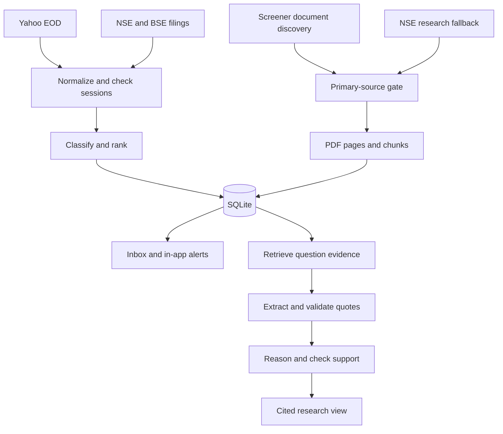

# FINN: architecture and product decisions

## Product point of view

The first screen is a triage desk, not a chat box. An investor should identify the few changes that deserve attention, open the original disclosure, and leave. Research starts with a specific question and returns a short argument with its evidence.

The inbox has three levels: attention (priority 70+), review (20–69), and collapsed routine items (below 20). These scores are transparent product rules, not calibrated probabilities of market impact. Unknown filings go to review. Nothing in the selected window is dropped: routine items remain inspectable, and duplicate filings retain all source links. Price observations are also retained, with ordinary sessions collapsed.

Examples of the judgment encoded in the rules:

| Event | Treatment | Reason |
| --- | --- | --- |
| Actual quarterly financial results | Attention | Newly reported operating performance |
| Notice of a board meeting to consider results | Routine | No financial outcome yet |
| Newspaper reproduction of results | Routine | Repetition, not a new result |
| CFO/CEO resignation or appointment | Attention | Leadership/continuity risk; inspect effective date and reason |
| Rating downgrade or explicit default | Highest priority | Funding or credit risk changed |
| Rating reaffirmation | Review | Often no change in the investment case |
| Routine certificate mentioning auditor resignation | Highest priority | Substance overrides the administrative label |
| Unknown subject | Review | Uncertainty is not a reason to hide it |

The rule classifier is intentionally small and explainable. Its recall is not established by the current test suite. A human-labelled filing set is the next evaluation task, especially for multi-event disclosures, negation and ambiguous exchange subjects. A small LLM may enrich classifications, but cannot lower deterministic risk priority.

## Stack

| Layer | Prototype choice | Why |
| --- | --- | --- |
| Mobile interface | HTML, CSS, browser JavaScript; PWA shell | Three views, no frontend build chain, fast initial load, accessible form controls |
| API | Python 3.12 + FastAPI | Same process/language as financial ingestion and PDF parsing |
| Data | SQLite in WAL mode on persistent disk | Enough for one user and 18 companies; easy setup and reproducible state |
| Retrieval | In-process BM25-style lexical scoring | No embedding fees, no vector service; company corpus is small |
| Worker | Separate Python process | Filings continue to be ingested when the browser is closed |
| PDF text | PyMuPDF | Page provenance and faster parsing of long annual reports |
| Models | Configurable small extraction + stronger reasoning endpoints | Spend on the inference the investor asked for |
| Delivery | Docker Compose, one app and one worker | Consistent runtime and shared durable state |

Next.js with TypeScript would be a sensible next interface when view/state complexity grows. Expo is justified if native background notifications become the central workflow. Neither is needed to prove this two-workflow prototype. The Python endpoints and source contracts can stay the same.

## Pipeline

### Price and volume

Use `yfinance.Ticker(symbol + '.NS').history(period='6mo', interval='1d', auto_adjust=False, actions=True, repair=True)`. Read `Adj Close` explicitly and call the displayed change an adjusted-close move. This is a total-return-adjusted signal, not an unadjusted tape-price return. A BSE-only extension would resolve the security's BSE code and use `.BO`; the current selected universe is NSE symbols.

Accept today's bar only after 18:30 IST. Use the vendor's dated sessions rather than assuming every weekday is a trading day. Display the actual last session: a Friday bar shown on Sunday is still a Friday observation, not Sunday's price.

For volume, the baseline is the previous N completed sessions, excluding the current bar. Require N usable sessions. Suppress volume comparison when a split falls in that window or volumes are invalid. Use strict `>` thresholds. Invalid prices or non-positive prior prices do not produce returns. Price and volume alerts have independent durable identities, one per symbol/session/rule.

A worker retries failed EOD runs. Source corrections for the same session update the observation but do not create a duplicate alert for the same rule. Changes to watch rules apply to subsequent ingestion; existing alerts remain an audit trail.

### Corporate announcements

Poll NSE's public feed with a bounded date window. BSE is a separate paginated adapter, using the BSE code found on the company's Screener page. Normalize broadcasts to timezone-aware UTC values while displaying IST in the UI. Preserve source URLs, raw extracted text, publication time, category and ranking explanation.

Download each filing when available. Run cheap rules first, then optional extraction-model enrichment on substantive documents. A failed attachment does not erase the headline. Failure status remains attached to the event. Revisit sources after the cache interval to detect changed content; a changed body becomes a separate event for now.

Identical content across exchanges shares an event ID derived from symbol, UTC calendar date and whitespace-normalized text. This is an exact-content deduplication strategy. It does not claim to recognize semantically equivalent filings with different covers. Full revision chains, issue-specific materiality thresholds and audited event identity are next steps.

For quarterly results, extract only explicitly reported Revenue, EBITDA, PBT and PAT for discrete three-month periods. Values must occur in the cited passage. Comparisons require the same metric, currency/unit, duration and accounting scope. Prior-quarter and prior-year periods must match exactly. Conflicting values, missing figures and zero/negative comparison bases yield gaps, not misleading percentage growth. Do not substitute operating profit for EBITDA or infer a Q4 from annual-minus-nine-month figures in this version.

### Screener and primary evidence

Screener is a locator. Parse its Annual reports and Concalls link sections, verify the requested NSE symbol, identify the company website and BSE code, and accept only issuer/exchange links. Standardized financial tables are also parsed and cached for diagnostics; those tables do not enter the Pull evidence store. AI-summary buttons, presentations, recordings, ratings and commentary are excluded.

NSE provides an independent fallback when a discovered PDF is unavailable. Annual reports are deduplicated by fiscal year in the fallback candidate list, preferring the most recent submission. Transcript discovery requires earnings/conference-call wording and rejects AGM and investor-day transcripts. Some Screener concall rows are broader events; the document text still needs to support any research claim.

Only `annual_report` and `transcript` are legal research document kinds. Exchange results may enrich Push, but are never silently promoted into Pull. Downloads enforce HTTPS, approved host suffixes, redirect revalidation and size/page budgets. Normal network access checks public DNS addresses; deployments should also enforce outbound restrictions at the network layer. Page text, content hash, source URL, discovery URL and fetch time are retained.

### Research

1. Build approximately 3,200-character page-local chunks with overlap. Do not merge pages and lose citation coordinates.
2. Retrieve at most 12 passages. Reserve useful passages across documents, then fill remaining slots with at most three per document. A 400-page annual report should not swamp every call transcript.
3. A small model extracts at most 12 claims with exact quotes. Reject invalid IDs and nonmatching quotes in code. Pass the quoted evidence, rather than the extractor's paraphrases, to reasoning.
4. The stronger model returns at most five claim/implication pairs and explicit evidence gaps. It has no browsing or external tools. Implications are labelled as inferences.
5. A small-model support check filters draft points. Fail closed to source passages if a model or validation step fails.
6. Show the documents searched, retrieval/fetch dates, publication-date gaps and page links. Primary-source restriction is enforced structurally; no prompt asks the model to supply a company profile from memory.

The prototype answers pointed questions about business mix, cash quality and management guidance. It does not advertise a completed promise-versus-delivery matrix. That requires a structured metric ledger with original guidance date, target fiscal period, metric definition, units, constant/reported-currency basis, scope, guidance revisions and matching realized outcomes. Four recent transcripts are not sufficient if the promises refer to a later annual period.

## Cost controls

| Work | Execution |
| --- | --- |
| Fetching, parsing, date arithmetic, ranking, thresholds and retrieval | Code; no model |
| Filing enrichment, financial extraction and quote ledger | Small model |
| Interpretation of selected evidence | Stronger model, only after an explicit research request |
| Support check | Small model |
| Repeated identical prompt/model/evidence | Persistent cache hit |

A typical uncached deep-research request uses two small-model calls and one stronger-model call. The exact bill depends on selected provider prices; no unverified rupee estimate is hard-coded. The default ceiling is 50 attempted calls per UTC day, with reserved calls counted before execution so concurrency cannot exceed the budget. This is a call ceiling, not a dollar budget; a production version should also reserve model-specific token cost. Keep separate per-user limits when adding team accounts.

## What remains before production

Replace in-memory jobs with a durable queue, move SQLite to Postgres, store original PDFs in object storage, add filing revision chains, background Web Push with an outbox/retry policy, team authentication, and a human-reviewed extraction/relevance evaluation set. Review dependency and upstream data-use terms before commercial distribution; the prototype is an assessment build. Do not deploy it on an ephemeral disk or treat its model verifier as a financial audit.

## Source references

The requirements are the supplied ENAM challenge brief and reference glossary. Technical integrations were checked against these primary pages on 8 November 2026:

- Yahoo client behavior: https://ranaroussi.github.io/yfinance/reference/yfinance.price_history.html
- Adjustment/repair behavior: https://ranaroussi.github.io/yfinance/advanced/price_repair.html
- NSE announcement surface: https://www.nseindia.com/companies-listing/corporate-filings-announcements
- NSE annual-report surface: https://www.nseindia.com/companies-listing/corporate-filings-annual-reports
- Screener document and table structure: https://www.screener.in/company/INFY/consolidated/
- Model API contract: https://developers.openai.com/api/reference/resources/chat

Public exchange endpoints are operational dependencies, not promised stable APIs. Schema changes fail explicitly rather than silently dropping records.
